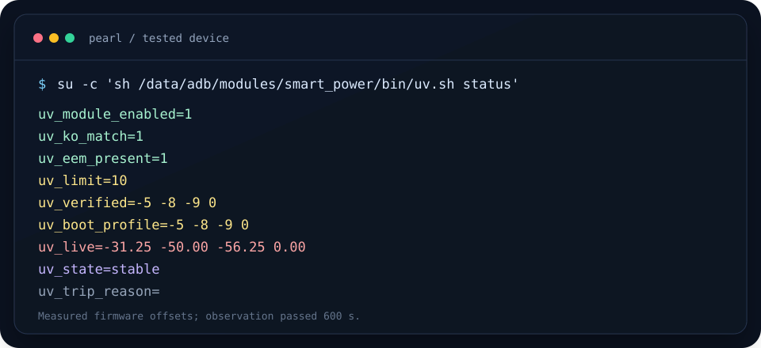

# Dimensity 8000/9000 cpuhvfs

**天玑 8000/9000（MT6895/MT6896）开源 CPU 降压驱动，打包为内核锁定的 Magisk 模块。**

[English](README.md) · [构建说明](docs/BUILD.md) · [Smart Power 集成](docs/INTEGRATION.md) · [安全模型](docs/SAFETY.md)

[](LICENSE)
[](https://github.com/topjohnwu/Magisk)
[](https://www.android.com/)
[](docs/COMPATIBILITY.md)
[](https://github.com/mo2g/dimensity-8000-9000-cpuhvfs/releases)

> [!WARNING]
> 这是实验性内核模块，不是通用降压 App。
> 仓库内的 `.ko` 只适用于 `5.10.136-pearl-cve43499`；内核不匹配时安装器和
> `cpuhvfs-ctl` 都会拒绝。使用前必须备份 `boot`。



*这是已验证设备上的示例输出。`uv_live` 是实测固件偏移，不是请求值。*

## 为什么做这个项目

原来的闭源「天玑8000/9000降压」模块已经停止维护，并且依赖跨内核强行加载的
`.ko`。本项目从 Xiaomi `pearl-s-oss` 内核树中的 MediaTek `cpufreq_v1` 源码
重新构建驱动，并加上内核版本、依赖、冲突和状态检查。

项目刻意保持窄范围：**一个设备家族、一个已知可用的内核二进制、默认只加载驱动。**
不把“一个 `.ko` 适用于所有天玑手机”当作卖点。

## 特性

- **真实厂商源码**：来自 Xiaomi pearl 内核树的 MediaTek `cpuhvfs`，GPL-2.0。
- **内核锁定**：加载前检查 `vermagic` 和 vendor 符号 CRC。
- **安全默认**：service 只加载驱动，不自动写入任何降压值。
- **状态隔离**：使用 `/data/adb/dimensity-8000-9000-cpuhvfs/state`，避免通用 `/data/adb/cpuhvfs` 冲突。
- **重启熔断**：观察期内重启会在下次启动触发 trip，禁止自动加载。
- **Smart Power 接入**：提供 `power.conf` 契约和已测试的 integration patch。
- **可审计构建**：源码、配置、vendor CRC 和复现步骤都在仓库内。

## 已验证配置

以下是发布二进制实际验证过的环境，不代表所有同芯片机型：

| 项目 | 已验证值 |
|---|---|
| 设备 | Redmi Note 12T Pro (`pearl`) |
| SoC | MediaTek Dimensity 8200-Ultra (`MT6895`) |
| ROM | MIUI 14 V14.0.5.0.TLHCNXM / Android 13 |
| 内核 | `5.10.136-pearl-cve43499` |
| Root | Magisk 30.6 |
| Smart Power | managed 模式 |
| 配置 | little `-5`、middle `-8`、big `-9`、cci `0` |
| 实测偏移 | `-31.25 / -50.00 / -56.25 / 0.00 mV` |
| 观察期 | 600 秒通过，状态 `stable` |

> `-5 / -8 / -9 / 0` 是这台设备上已经测试过的 Smart Power 配置。
> `cpuhvfs-ctl` 独立路径的默认值更保守：`max_abs_steps=6`，约 `-37.5 mV`。

## 快速开始

### 1. 刷入前

1. 备份 `boot_a`，确认回滚命令；
2. 禁用旧的 `dimensity_8100_9000_cpuhvfs` 并重启；
3. 确认没有残留驱动：

```sh
su -c 'lsmod | grep ^cpuhvfs || true'
su -c 'ls -l /proc/eem/eem_offset 2>/dev/null || true'
```

本模块是 systemless 模块，不格式化、不清除用户数据，也不修改 `boot`。但内核实验
仍然必须备份，并知道如何回滚。

### 2. 安装

从 [GitHub Releases](https://github.com/mo2g/dimensity-8000-9000-cpuhvfs/releases) 下载最新 zip，在 Magisk 中安装，然后按正常流程重启一次，
让 Magisk 完成模块激活。

如果旧驱动已经卸载且 `/proc/eem` 不存在，可以参考免重启切换流程：
[`docs/NO-REBOOT-SWITCH.md`](docs/NO-REBOOT-SWITCH.md)。

### 3. 探测和加载

```sh
su -c '/data/adb/modules/dimensity-8000-9000-cpuhvfs/bin/cpuhvfs-ctl probe'
su -c '/data/adb/modules/dimensity-8000-9000-cpuhvfs/bin/cpuhvfs-ctl load'
su -c '/data/adb/modules/dimensity-8000-9000-cpuhvfs/bin/cpuhvfs-ctl status'
```

安装本身不会改变电压。

### 4. 使用保守配置测试

```sh
# little / middle / big / cci，单位是 EEM 档
su -c '/data/adb/modules/dimensity-8000-9000-cpuhvfs/bin/cpuhvfs-ctl apply -3 -3 -3 0'
```

恢复并卸载：

```sh
su -c '/data/adb/modules/dimensity-8000-9000-cpuhvfs/bin/cpuhvfs-ctl restore'
su -c '/data/adb/modules/dimensity-8000-9000-cpuhvfs/bin/cpuhvfs-ctl unload'
```

如果出现 `trip=reboot_during_observation`，先确认设备稳定，再执行：

```sh
su -c '/data/adb/modules/dimensity-8000-9000-cpuhvfs/bin/cpuhvfs-ctl reset-trip'
```

## Smart Power 集成

在 `/data/adb/smart-power/power.conf` 加入：

```ini
uv_module_id=dimensity-8000-9000-cpuhvfs
uv_ko_path=/data/adb/modules/dimensity-8000-9000-cpuhvfs/lib/cpuhvfs.ko
uv_keep_module_enabled=1
```

如果 Smart Power 的 `uv.sh` 还不认识这些键，应用：

```sh
cd /data/adb/modules/smart_power
patch -p1 < /data/adb/modules/dimensity-8000-9000-cpuhvfs/patches/smart-power-uv.patch
```

然后按 Smart Power 正常流程应用：

```sh
su -c 'sh /data/adb/modules/smart_power/bin/uv.sh apply 0'
su -c 'sh /data/adb/modules/smart_power/bin/uv.sh persist on'
su -c 'sh /data/adb/modules/smart_power/bin/uv.sh status'
```

`uv_keep_module_enabled=1` 用于阻止 Smart Power 给本模块写 `disable`。本模块的
service 只加载驱动，不负责写入偏移，因此可以保持 Magisk 模块启用，由 Smart Power
负责实际偏移和熔断。

> `cpuhvfs-ctl status` 只记录通过 `cpuhvfs-ctl apply` 写入的状态。
> Smart Power 直接写 `/proc/eem` 时，请看 `uv.sh status` 或 `powerctl status`。

## 兼容性

仓库中的 `lib/cpuhvfs.ko` 只支持上面的内核。其他内核、ROM 或机型必须使用对应
内核源码、`Module.symvers`、工具链和 vendor 模块 CRC 重新构建。

详见 [docs/COMPATIBILITY.md](docs/COMPATIBILITY.md) 和
[docs/BUILD.md](docs/BUILD.md)。

## 文档

| 文档 | 内容 |
|---|---|
| [docs/INTEGRATION.md](docs/INTEGRATION.md) | Smart Power 契约、退出码、状态字段 |
| [docs/NO-REBOOT-SWITCH.md](docs/NO-REBOOT-SWITCH.md) | 已验证的免重启切换流程 |
| [docs/BUILD.md](docs/BUILD.md) | 为其他内核重新构建 `.ko` |
| [docs/SAFETY.md](docs/SAFETY.md) | 限幅、观察期、回滚和熔断 |
| [docs/COMPATIBILITY.md](docs/COMPATIBILITY.md) | 兼容性矩阵和构建要求 |
| [docs/ARCHITECTURE.md](docs/ARCHITECTURE.md) | 模块、驱动、`/proc/eem` 和 Smart Power 数据流 |
| [docs/FAQ.md](docs/FAQ.md) | 安装、内核和安全常见问题 |
| [CONTRIBUTING.md](CONTRIBUTING.md) | Bug、测试和 PR 规范 |
| [docs/LAUNCH.md](docs/LAUNCH.md) | 发布、社区和推广清单 |
| [ROADMAP.md](ROADMAP.md) | 后续计划 |

## 项目结构

```text
bin/cpuhvfs-ctl       命令行和安全检查
bin/lib.sh            状态、路径、写入辅助
lib/cpuhvfs.ko        内核锁定的预编译驱动
src/                  MediaTek cpufreq_v1 源码（GPL-2.0）
etc/limits.conf       保守限幅和观察期
configs/              设备配置和 vendor 符号 CRC
patches/              Smart Power 集成 patch
docs/                 构建、安全、兼容性、架构文档
```

## 贡献与支持

- 提交 PR 前阅读 [CONTRIBUTING.md](CONTRIBUTING.md) 和 [CODE_OF_CONDUCT.md](CODE_OF_CONDUCT.md)；
- 提 Bug 请附 `uname -r`、`cpuhvfs-ctl status`、`uv.sh status` 和相关 `dmesg`；
- 不要只发布跨内核二进制，必须同时提供对应源码、配置和符号来源；
- 如果项目对你有帮助，点一个 Star 能让更多天玑用户找到它。

## 许可与归属

驱动源码来自 MediaTek，经 Xiaomi pearl 内核树分发；原始版权和 GPL-2.0 声明保留。
详见 [LICENSE](LICENSE) 和 [THIRD_PARTY_NOTICES.md](THIRD_PARTY_NOTICES.md)。

本项目与 Xiaomi、MediaTek、Magisk、Smart Power 均无隶属关系。使用风险由设备所有者承担。
