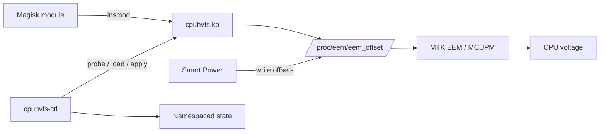
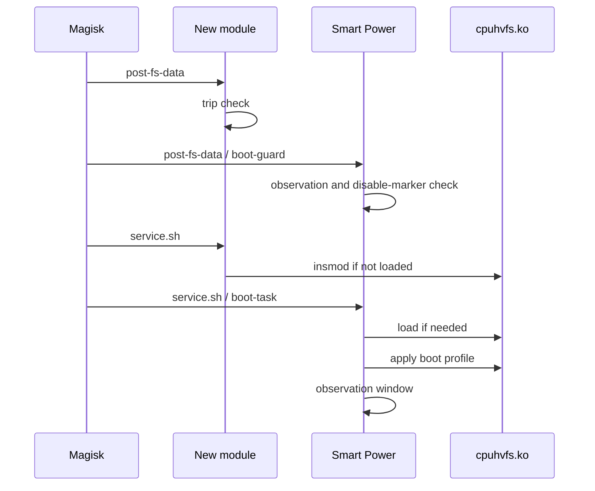

# Architecture

## Data flow



## Components

### Magisk module

`service.sh` loads `lib/cpuhvfs.ko` only. It never writes a voltage offset.
`post-fs-data.sh` checks whether the previous boot ended while a standalone
profile was armed. If so, it creates a trip file and prevents automatic loading.

### `cpuhvfs.ko`

The kernel module is built from MediaTek `cpufreq_v1` source. It exposes the
EEM debug interface at `/proc/eem` and communicates with the vendor MCUPM IPI
channels. The module name `cpuhvfs` and the `/proc/eem` path are global kernel
resources; only one cpuhvfs driver can be loaded at a time.

### `cpuhvfs-ctl`

The CLI provides a small machine-readable contract:

```text
probe  -> verify kernel, ko, dependencies, and conflicts
load   -> insmod and wait for /proc/eem/eem_offset
apply  -> ramp four cluster offsets through the safety limits
restore-> write zero offsets
unload -> restore, rmmod, clear runtime state
status -> print key=value state
```

The standalone state lives under `/data/adb/<module-id>/`. This is separate
from the kernel-global `/proc/eem` interface.

### Smart Power

Smart Power owns the tested `-5 / -8 / -9 / 0` profile and its observation and
crash circuit breaker. In managed mode it writes `/proc/eem/eem_offset`
directly. The integration patch only teaches Smart Power where this module and
its `.ko` live; it does not change the profile.

### Why state is namespaced

`/data/adb/cpuhvfs` is not tied to a Magisk module ID. Two modules using that
path can overwrite each other's `state`, `trip`, `armed`, and `config`. This
project uses `/data/adb/dimensity-8000-9000-cpuhvfs` so files cannot collide.
Kernel names cannot be namespaced this way, so the installer and CLI reject a
foreign driver or `/proc/eem` instead.

## Boot sequence


